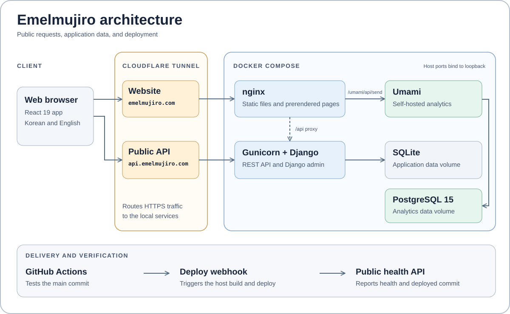

# Emelmujiro

<div align="center">

[](https://github.com/researcherhojin/emelmujiro/actions/workflows/main-ci-cd.yml)
[](https://codecov.io/gh/researcherhojin/emelmujiro)
[](LICENSE)

**[Live Site](https://emelmujiro.com)** | **[Contributing](CONTRIBUTING.md)** | **[Changelog](CHANGELOG.md)** | **[Issues](https://github.com/researcherhojin/emelmujiro/issues)**

</div>

AI education, consulting & development — React 19 + Django 6 monorepo, self-hosted via Docker behind a Cloudflare Tunnel.

<p align="center">
  
  
</p>

## Tech Stack

**Frontend**<br/>


**Backend**<br/>


**Testing**<br/>


**Infra**<br/>


## Getting Started

**Prerequisites**: Node >= 24, Python 3.12, [uv](https://docs.astral.sh/uv/)

```bash
git clone https://github.com/researcherhojin/emelmujiro.git
cd emelmujiro
```

On macOS, `make setup-dev-machine` installs dependencies, creates local environment files and applies migrations. Then run `make verify-setup` and `npm run dev`.

For a manual setup, create `backend/.env` from `backend/.env.example`, set a local `SECRET_KEY` and `DEBUG=True`, and leave `DATABASE_URL` empty to use SQLite. Then run the commands below. [Django deployment checklist](https://docs.djangoproject.com/en/6.0/howto/deployment/checklist/#secret-key)

```bash
make install                                              # npm install + uv sync --extra dev
(cd backend && uv run python manage.py migrate)           # First-time DB setup
npm run dev                                               # Frontend :5173 + Backend :8000
```

The local and Docker backends both use port 8000, so run one at a time.

For a local Compose stack, the root `.env` supplies port settings and the two Umami credentials. Use URL-safe values in place of the placeholders in `.env.example`. Compose reads Django server settings separately from `backend/.env.production`. [Docker Compose interpolation](https://docs.docker.com/compose/how-tos/environment-variables/variable-interpolation/)

### Useful Commands

Run from the repo root unless noted otherwise.

```bash
make test                  # All tests (frontend + backend)
make lint                  # All linters
make lint-fix              # Auto-fix lint issues
make update-test-counts    # Regenerate README test counts locally (CI auto-syncs on main)
make health                # Docker health diagnostic (containers, resources, endpoints)
npm run security:dependencies  # Audit npm dependencies and scan all four lock files

# From frontend/: npm run validate (lint + type-check + coverage) and npm run test:e2e (Playwright).
# Single-test, serve:build, bundle-analysis, route-check and visual-diff commands are listed once, in CLAUDE.md → Commands.
```

For Mobile Chrome, Mobile Safari, and optional Brave emulation, see the [mobile browser checks](CONTRIBUTING.md#mobile-browser-checks).

The dependency audit includes development dependencies. Run `npm run security:setup` to install the pinned Trivy binary and `npm run security:images` on the Docker host to scan its running images. Detailed reports stay in `backend/logs/security/`. [Security runbook](docs/intents/infra/security-monitoring.md#manual-operation) · [npm audit documentation](https://docs.npmjs.com/cli/v11/commands/npm-audit/) · [Trivy vulnerability scanning](https://trivy.dev/docs/latest/guide/scanner/vulnerability/)

### Deployment checks

1. **Check container health.** From the repository root on the Docker host, confirm all four services report `healthy`.

   ```bash
   make ps
   ```

2. **Review recent logs.** On the Docker host, check the last 24 hours for startup errors and HTTP `5xx` responses. The command returns at most 200 lines per container. [Docker Compose logs](https://docs.docker.com/reference/cli/docker/compose/logs/)

   ```bash
   docker compose logs --since 24h --tail 200 backend frontend umami umami-db
   ```

3. **Verify the deployed commit.** Confirm `status` is `healthy` and `commit` matches the SHA tested by the run that triggered the deployment. [Main CI/CD](https://github.com/researcherhojin/emelmujiro/actions/workflows/main-ci-cd.yml)

   ```bash
   curl -fsS https://emelmujiro.com/api/health/
   ```

4. **After an analytics database upgrade, verify PostgreSQL separately.** Check the running server version and follow the release's instructions for any affected indexes. [Umami database verification](docker/umami/README.md#database-verification)

## Architecture



- **Website and API.** Cloudflare Tunnel routes the website to nginx and the API hostname directly to Gunicorn and Django. nginx serves the frontend build and also proxies same-origin `/api` requests.
- **Application data and analytics.** Django stores application data in SQLite. nginx forwards the tracker endpoint to Umami, which stores analytics in PostgreSQL 15.
- **Deployment.** GitHub Actions tests the commit and calls the deploy webhook. The host builds the frontend and backend. Django applies migrations at startup, and the public health endpoint reports the deployed commit.

[Cloudflare Tunnel documentation](https://developers.cloudflare.com/cloudflare-one/networks/connectors/cloudflare-tunnel/) · [Deployment rules](.claude/rules/backend.md#deployment) · [Umami image recipe](docker/umami/README.md)

## Key features

- **Bilingual routes.** Korean pages use the default URLs. English pages use `/en`.
- **Teaching history.** Browse 47 entries from 2022–2026 and filter by four organization types.
- **Insights.** Rich-text posts support images, likes, and threaded comments. English pages show current translations and fall back to Korean. [Blog API rules](.claude/rules/backend.md#architecture)
- **Authentication.** HttpOnly JWT cookies, CSRF protection, and token revocation after password changes. [Authentication tests](CONTRIBUTING.md#testing)
- **Testimonials.** Two scrolling rows feature enterprise and 고용노동부 K-디지털 reviews.
- **Monitoring and error recovery.** Self-hosted Umami analytics and scheduled Docker health checks. React shows a localized retry screen after rendering errors. [Operations runbook](docs/intents/infra/security-monitoring.md#manual-operation)
- **SEO and performance.** JSON-LD, 10 prerendered routes, and a multilingual sitemap. CI checks bundle size and runs Lighthouse. [Build and SEO rules](.claude/rules/frontend-build.md)
- **Security.** The app sanitizes blog HTML and validates uploads. Scheduled checks audit dependencies and running images and verify encrypted backups can be restored. [Backend security](.claude/rules/backend.md#security) · [Security operations](docs/intents/infra/security-operations.md)
- **Privacy policy.** Korean and English pages cover collection, retention, and user rights at `/privacy` and `/en/privacy`.
- **Tests.** Vitest (1273 tests), Django unittest (455 tests), Node sitemap regression tests (12 tests), and Playwright E2E (5 default profiles).
- **CI/CD.** GitHub Actions checks pull requests, deploys verified `main` commits, and monitors deployment drift. [CI and deployment rules](.claude/rules/ci.md)

## Documentation

- [Contributing](CONTRIBUTING.md) and [repository rules](CLAUDE.md)
- [Frontend](.claude/rules/frontend.md), [build and routing](.claude/rules/frontend-build.md), and [backend](.claude/rules/backend.md)
- [CI and deployment](.claude/rules/ci.md), [security operation history](docs/intents/infra/security-operations.md#alarm-history), and [Umami image recipe](docker/umami/README.md)
- [Module intents and their statuses](docs/intents/README.md#modules)
- [Security reporting contact](https://emelmujiro.com/.well-known/security.txt)

## License

[GNU Affero General Public License v3.0](LICENSE)
